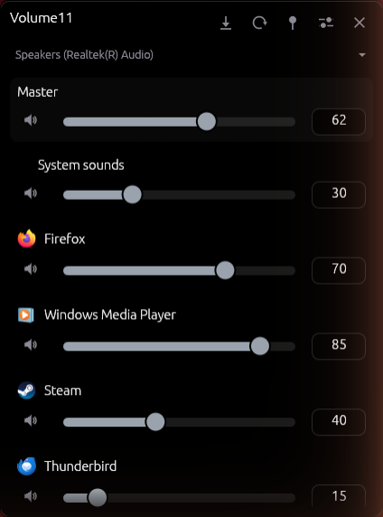
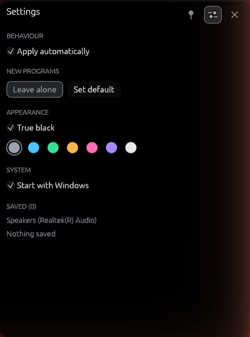
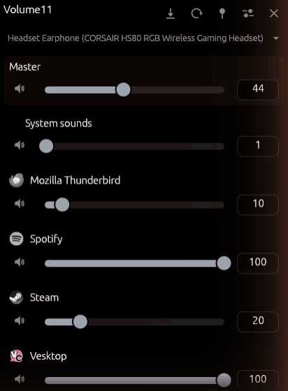

# Volume11

Per-application volume for Windows 11, from the notification area.

Windows forgets. Volume11 stores a level per program and sets it again when that
program starts playing.

<br clear="left">




## Features

- Levels stored per executable, kept across restarts and updates
- One row per program, covering all of its audio sessions
- Applied automatically when a program starts playing
- Switch the output device from the window; each device keeps its own levels
- Follows the default output device when it is changed elsewhere
- Event driven, no polling
- Application icons read from the executables
- True-black theme, seven accents
- Autostart, switchable from Task Manager
- Closing the window keeps it running in the tray
- One instance at a time
- Updates from the settings, with a small dot on the settings button when one is out

## Install

Download `Volume11-Setup.exe` from the
[latest release](https://github.com/Benett53/Volume11/releases/latest) and run it.

Installs per user under `%LOCALAPPDATA%\Programs\Volume11`, no administrator
rights. Running the setup elevated installs to Program Files instead. A new
release installs over an older one and keeps its settings. Uninstall through
Windows Settings removes the program, shortcuts and autostart entry; it asks
before deleting saved volumes.

`Volume11.exe` is attached to the release as well, for a portable copy.

The build is not code-signed, so SmartScreen warns once.

## Using it



| Action | How |
|---|---|
| Open or close | Left-click the tray icon |
| Menu | Right-click the tray icon |
| Switch output device | Click the device name |
| Save current levels | Save button |
| Apply saved levels | Apply button |
| Move the window | Drag the empty part of the header |
| Keep it on top | Pin button |
| Hide | `Esc`, ✕, or Alt+F4 |
| Quit | Tray menu → Quit |

Closing only hides. The window opens at the bottom right of the primary
monitor, above the taskbar, whatever its resolution or scaling. Dragging moves
it for now; the next open puts it back.

Flags:

- `--show` opens the mixer immediately
- `VOLUME11_CONFIG=<path>` for a portable configuration file

## Configuration

`%APPDATA%\Volume11\config.json`:

```json
{
  "version": 2,
  "settings": {
    "auto_apply": true,
    "unknown_app_policy": "leave_alone",
    "default_volume": 50,
    "always_on_top": false,
    "start_with_windows": false,
    "accent": "#9AA3AD",
    "oled_black": true
  },
  "devices": {
    "{0.0.0.00000000}.{2e3dc39e-…}": {
      "label": "Headset Earphone",
      "apps": {
        "spotify.exe": { "volume": 45, "muted": false, "label": "Spotify" }
      }
    }
  }
}
```

Levels are kept per playback device, keyed by its endpoint id. Windows itself
stores per-program volume per device, so one level per program across all
devices would fight it on every switch. A version 1 file is migrated on the
first start: its levels move to the device in use.

`unknown_app_policy`: `leave_alone` or `apply_default`.

Autostart lives in the registry, not here, so Task Manager and Volume11 agree on
it. Switching it off marks the entry disabled instead of deleting it, which is
why it stays listed under Startup. If the entry points at a copy that has been
deleted, the next start repoints it.

Written atomically. An unreadable file is moved to `config.json.broken`.

## Network

The only network access is the update check, which asks GitHub for the latest
release: when "Check for updates" is pressed, and at most once a day while
"Check automatically once a day" is on (Settings → Updates). Nothing else is
sent or received.

An update is installed only if `SHA256SUMS` carries a valid minisign signature
from the key built into Volume11 and the downloaded file matches its checksum.
The installed copy runs the new setup silently and starts again; a portable
`Volume11.exe` replaces itself.

## Building

```bash
cargo build --release
cargo test
cargo run --example smoke        # prints live devices and audio sessions
python tools/make-icon.py        # builds assets/icon.ico from assets/logo-source.png
```

The installer needs [Inno Setup](https://jrsoftware.org/isinfo.php):

```bash
ISCC.exe /DAppVersion=0.2.1 installer/volume11.iss
```

Releases are built with MSVC; the GNU toolchain works too.

## How it works

| Module | Responsibility |
|---|---|
| `src/audio/engine.rs` | Owns the COM objects on one thread, caches sessions by process id |
| `src/audio/callbacks.rs` | WASAPI callbacks, push into a channel and return |
| `src/audio/process.rs` | Process id to executable name and label |
| `src/audio/policy.rs` | Setting the default device through `IPolicyConfig` |
| `src/config.rs` | JSON, atomic writes |
| `src/tray.rs` | Tray icon and menu, own Win32 message loop |
| `src/instance.rs` | Single instance, and the installer's quit request |
| `src/autostart.rs` | `Run` key plus Task Manager status byte |
| `src/ui/` | Window, theme, slider, icons |
| `src/ui/placement.rs` | Primary monitor work area and taskbar geometry |

The UI thread never touches COM. It sends commands and receives events over
channels. egui runs reactively, so an idle Volume11 draws nothing.

Windows has no public API for changing the default playback device. The
Sound settings, EarTrumpet and SoundSwitch all use `IPolicyConfig`, an
undocumented COM interface unchanged since Windows 7; Volume11 does the same
and sets the device for all three roles, as the quick settings flyout does.

Rendering goes through `wgpu` on Direct3D 12. Windows ships no OpenGL past 1.1;
everything above comes from the GPU driver, so a machine on the Basic Display
Adapter has none. D3D12 is a Windows API with a software fallback and better
maintained drivers.

## History

A rewrite. The original was .NET 9 WPF with NAudio and EF Core/SQLite: 201 MB
plus six DLLs, and a one-minute timer that re-enumerated every audio session.

## License

MIT, see [LICENSE](LICENSE).

Parts of this project were created with AI assistance.
